# Pfandkasse

**Know what's in your bottle bag.**

Pfandkasse is a mobile app for scanning and counting deposit bottles under the German *Pfand* system. You scan your bottles at home before heading to the reverse vending machine, so you know in advance exactly how much deposit you'll get back. Every return is then saved to your history.

The app works completely offline, and all data stays on your device.

> The app's UI is in German, since it targets the German deposit system.

<p align="center">
  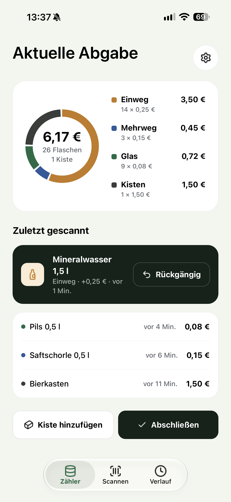
  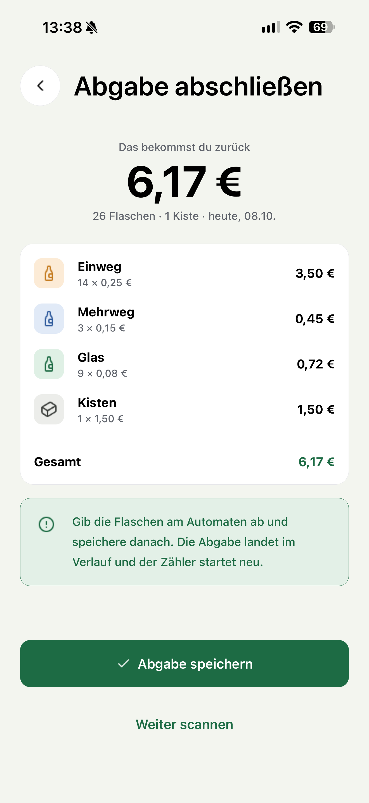
  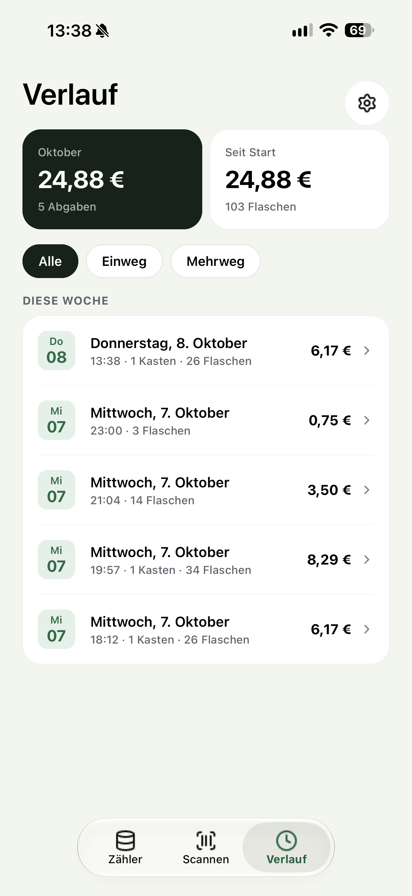
</p>

## Features

- **Barcode scanner** – hold a bottle up to the camera and the app detects its deposit type and adds it to the count
- **Learns as you go** – if the app doesn't know a bottle yet, you pick the deposit type once and it remembers it for the next scan
- **All deposit types** – single-use / *Einweg* (€0.25), reusable / *Mehrweg* (€0.15), reusable glass (€0.08) and crates (€1.50)
- **Crates in one tap** – predefined crate types (beer, water, soft drinks, juice, swing-top bottles) including bottle count, also for crates that aren't completely full
- **Live counter** – running total with a donut-chart breakdown by deposit type, plus recently scanned bottles with undo
- **History** – every return with monthly and all-time totals, filterable by single-use/reusable, with a detail view for each return
- **Settings** – adjustable deposit rates, scan sound and vibration, auto-add without confirmation, and a reminder to return your bottles
- **CSV export** of your history
- **Offline & private** – no cloud, no account; the camera only reads barcodes and never stores photos

## How it works

1. **Scan at home** – scan the barcode of each bottle; add whole crates with a single tap
2. **Keep track of the total** – the app counts along, so you know how much money is in the bag before you leave
3. **Return and complete** – after using the machine, tap *Abschließen* (complete); the return is saved to your history and the counter resets

## Screenshots

### Onboarding

| Welcome | Three steps | Deposit types | Camera |
|:---:|:---:|:---:|:---:|
| 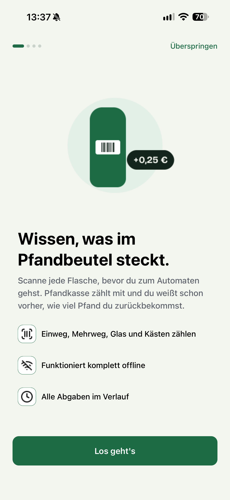 | 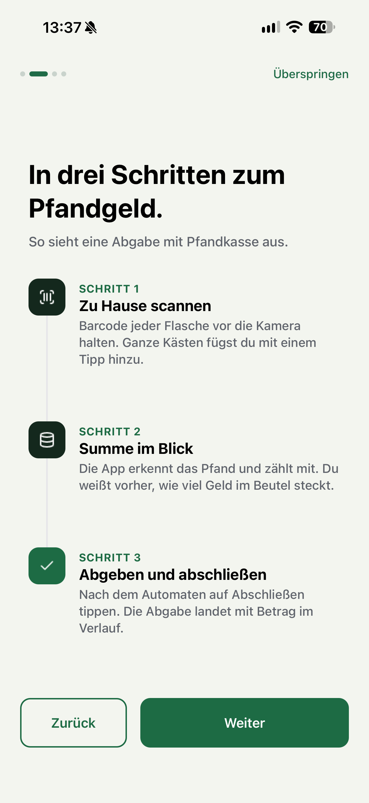 | 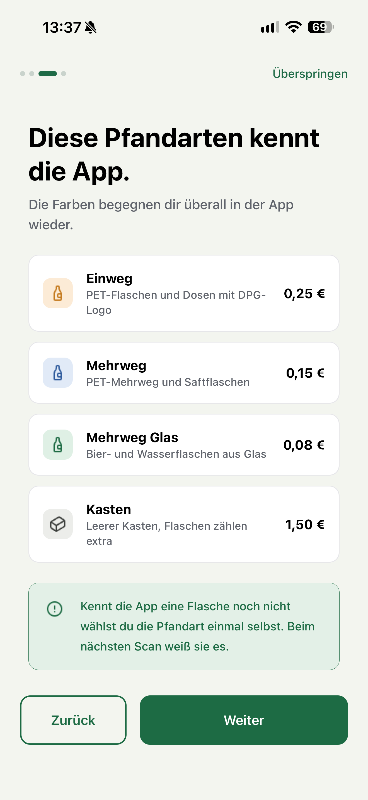 | 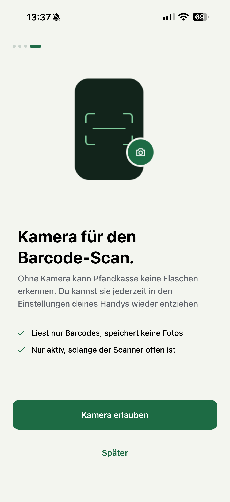 |

### Counting & returning

| Counter | Add crate | Complete return | Return saved |
|:---:|:---:|:---:|:---:|
|  | 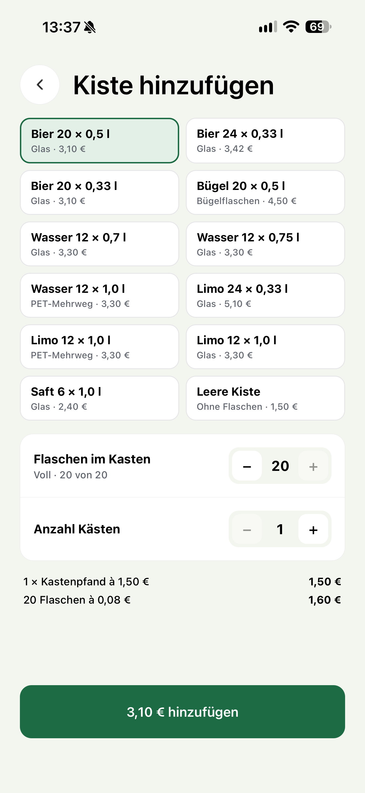 |  | 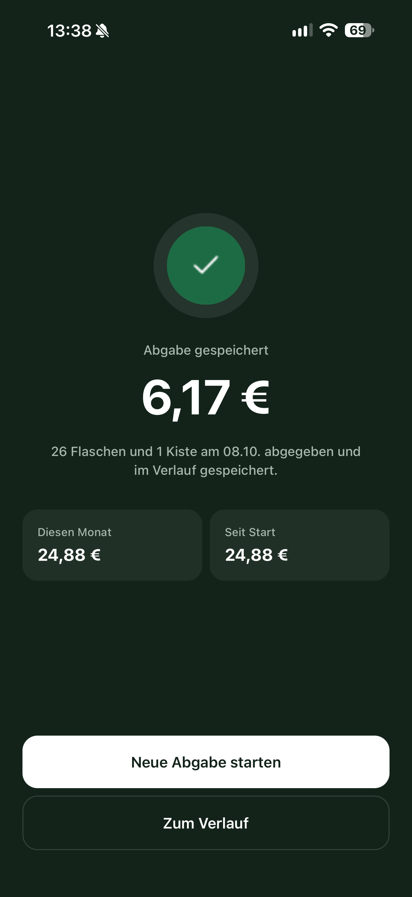 |

### History & settings

| History | Return details | Settings |
|:---:|:---:|:---:|
|  | 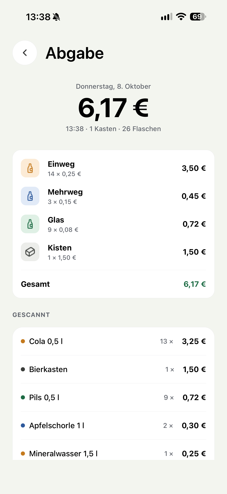 | 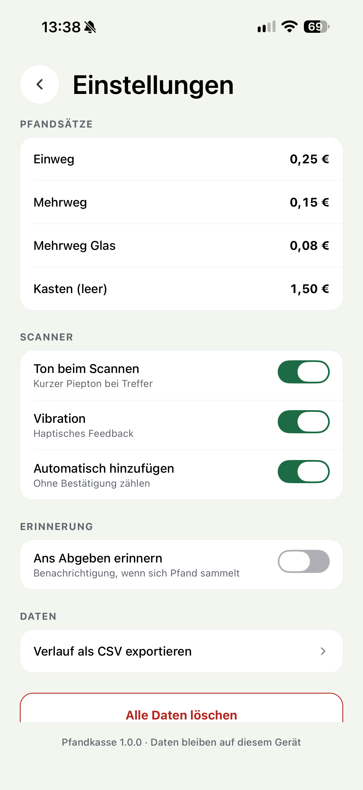 |

## Tech stack

- [React Native](https://reactnative.dev/) with [Expo](https://expo.dev/)
- TypeScript
- [AsyncStorage](https://react-native-async-storage.github.io/async-storage/) for local data storage
- Camera-based barcode scanning via Expo

## Getting started

Requirements: [Node.js](https://nodejs.org/) (LTS) and the [Expo Go](https://expo.dev/go) app on your phone.

```bash
git clone https://github.com/hziehe/pfandkasse.git
cd pfandkasse
npm install
npx expo start
```

Then scan the QR code in the terminal with Expo Go (Android) or the Camera app (iOS).

## Project status

Version 1.0.0 – the app is fully functional and runs on iOS and Android. It is not currently published on the App Store or Google Play.

## Author

**Hans Ziehe** – [GitHub @hziehe](https://github.com/hziehe)
